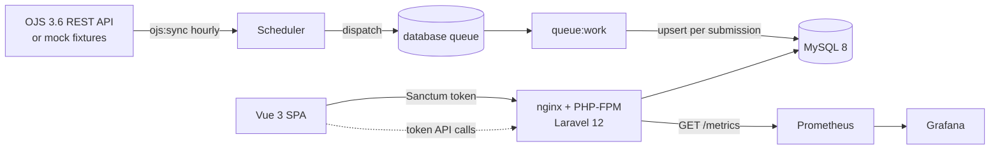
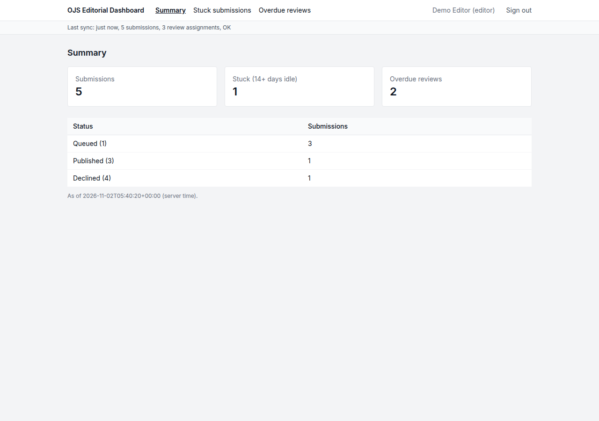
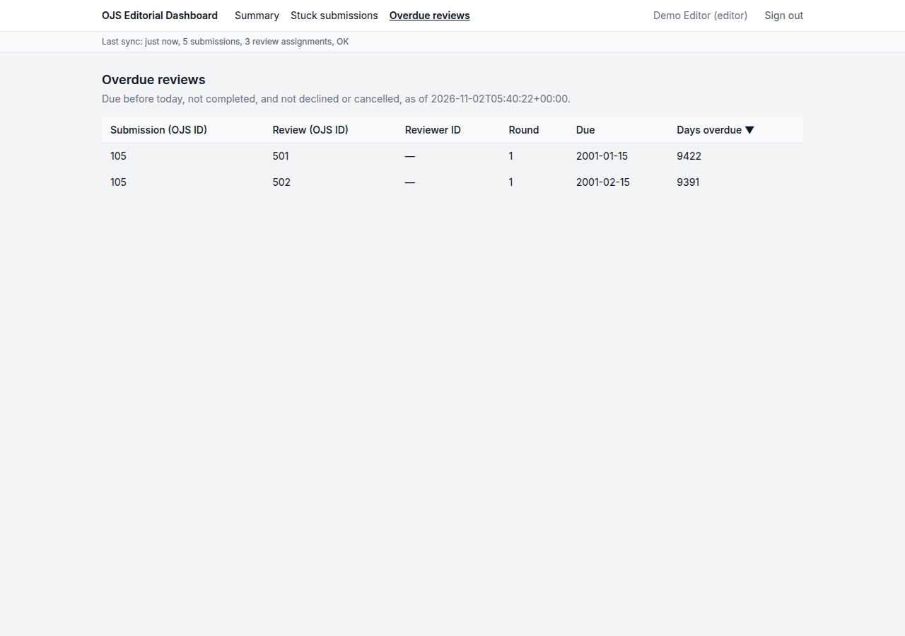
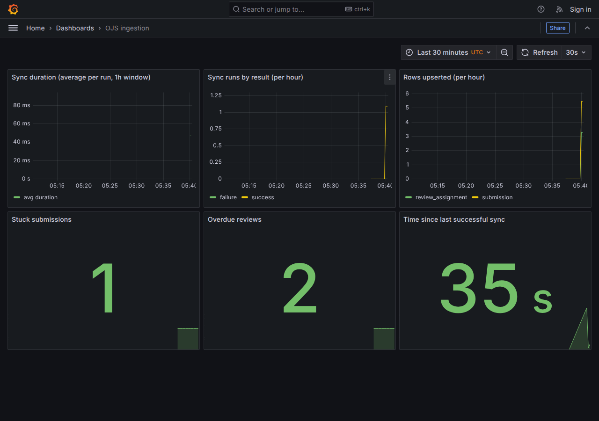

# OJS Editorial Dashboard

[](https://github.com/IV-cmd/ojs-editorial-dashboard/actions/workflows/ci.yml)

A personal learning project: an operational dashboard over OJS 3.6 REST API data for editorial teams — OJS ingestion, persistence, an authenticated JSON API, a Vue dashboard, Prometheus/Grafana observability, and container/Kubernetes deployment.

## Status

| Area | Status in repo |
| --- | --- |
| Laravel 12 / PHP 8.3 | Working application |
| MySQL 8 schema, models, factories, seeders | Done |
| OJS 3.6 client with fixture-backed mock mode | Done (mock is the default; no live OJS is called) |
| Idempotent ingestion queue jobs (`ojs:sync`) | Done |
| Authenticated JSON API with editor/viewer roles | Done |
| Vue 3 dashboard (summary, stuck submissions, overdue reviews) | Done (token sign-in) |
| Prometheus metrics, Grafana dashboard, sync run history | Done |
| Production image, docker compose stack, Helm chart, GitLab CI | Done |
| Pest / Pint / Larastan / Vitest | Configured; CI is on GitHub Actions |

### Mock mode

The OJS client defaults to a fixture-backed mock driver, so the app runs with no OJS instance and no token. Set `OJS_DRIVER=http` with real credentials to talk to a live server. The production environment refuses to boot with the mock driver.

### Architecture



## Run modes

Three ways to run the same application — all verified in this repo.

### 1. Local PHP/Node (no containers)

Requirements: PHP 8.3, Composer 2, Node.js 22, and MySQL 8. After `php artisan migrate --seed` the app ingests the bundled fixtures with `php artisan ojs:sync`.

```sh
composer install
npm install
cp .env.example .env
php artisan key:generate
npm run build
php artisan serve
```

For frontend development, use `npm run dev` instead of `npm run build`.

### 2. Docker Compose (full stack, one command)

```sh
make metrics    # docker compose up -d --build, then prints the URLs
make sync       # run another ojs:sync inside the app container
make down
```

This starts the app on http://localhost:8000 (mock OJS, seeded editor and viewer accounts, one sync on startup), a queue worker, the scheduler, MySQL, Prometheus on http://localhost:9090, and Grafana on http://localhost:3000. Grafana opens with the provisioned "OJS ingestion" dashboard (`deploy/grafana/dashboards/editorial.json`) and needs no login to view.

The same `Dockerfile` is used for compose and for Kubernetes: a multi-stage build producing a non-root (UID 10001) image running nginx + PHP-FPM on port 8080. `artisan serve` is not used in the container.

### 3. Helm (Kubernetes)

```sh
make image      # docker build -t ojs-editorial-dashboard:latest .
make deploy     # helm upgrade --install demo deploy/helm/ojs-dashboard
```

On a local `kind` cluster, load the image first (`kind load docker-image ojs-editorial-dashboard:latest`), then `helm install demo deploy/helm/ojs-dashboard`.

The chart ships the web Deployment (init containers for migrate/seed/sync), a queue-worker Deployment, an hourly `ojs:sync` CronJob, Service, ServiceAccount, ConfigMap, Secret, and a throwaway bundled MySQL (set `mysql.enabled=false` and `db.host` for an external database). Defaults in `values.yaml` run mock mode.

The app is not a controller: its ServiceAccount mounts no API token (`automountServiceAccountToken: false`), and pods run as UID 10001 with `readOnlyRootFilesystem` — writable dirs are `emptyDir` mounts.

## Checks

```sh
php artisan test
vendor/bin/pint --test
vendor/bin/phpstan analyse
npm test
npm run build
helm lint deploy/helm/ojs-dashboard && helm template demo deploy/helm/ojs-dashboard
```

CI mirrors these on GitHub Actions (`.github/workflows/ci.yml`). `.gitlab-ci.yml` is the equivalent pipeline for a GitLab-hosted copy (stages: test, build) — it does not run on GitHub; keep the two in sync when changing checks.

## Ingestion

`php artisan ojs:sync` dispatches `SyncSubmissions`, which lists submissions from the configured OJS client and dispatches one `IngestSubmission` job per submission. Each of those fetches the submission detail and passes it to `OjsUpserter`, which writes the submission and its nested review assignments in one database transaction. The scheduler in `routes/console.php` runs the sync hourly; in production a scheduler and a queue worker (`php artisan queue:work`) must both be running.

Writes are upserts keyed on OJS identifiers: `(context_id, ojs_id)` for submissions and `ojs_id` for review assignments. Running the sync again updates existing rows rather than adding new ones, and the unique keys in the schema reject duplicates if two runs overlap.

Upsert-only: a review assignment that disappears from OJS is not deleted locally. Deleting every assignment and reinserting it on each run would change local row IDs and lose the last known state, so pruning is left as a separate, explicit decision.

## API

JSON endpoints under `/api`, for the dashboard frontend. Full request/response contracts are in [`docs/api.md`](docs/api.md). Every endpoint requires a Laravel Sanctum token (`Authorization: Bearer <token>`). Without one the response is a JSON `401`. Authenticated requests are throttled to 60 per minute per user.

| Endpoint | Roles | Returns |
| --- | --- | --- |
| `GET /api/user` | any | The current user's id, name, email, and role |
| `GET /api/meta/filters` | any | Distinct `status` and `context_id` values present, for filter dropdowns |
| `GET /api/submissions` | editor | Paginated submissions with review assignment counts. Query: `status`, `context_id`, `per_page` (max 100), `page` |
| `GET /api/submissions/{id}` | editor | One submission (local `id`) with its review assignments |
| `GET /api/dashboard/summary` | any | Submission counts by status, total, stuck count, and overdue review count |
| `GET /api/dashboard/stuck` | any | Paginated stuck submissions, plus the threshold used |
| `GET /api/dashboard/overdue-reviews` | any | Paginated overdue review assignments |
| `GET /api/sync-runs/latest` | any | The latest sync audit row (status, counts, duration; error text for editors only) |

Roles:

- `editor` can see every endpoint, including `reviewer_id` on review assignments.
- `viewer` is the default for new users. It can see the dashboard endpoints. `reviewer_id` is left out of its responses, and the raw submission endpoints return `403`.

The schema deliberately stores only the numeric OJS reviewer ID, never reviewer names. Reviewer anonymity matters in peer review, so a viewer being unable to identify reviewers is enforced by the data model, not just by policy. Adding real names would be a deliberate schema change, not a missing feature.

Rules, implemented in `app/Services/Dashboard/EditorialQueries.php`:

- **Stuck:** status `1` (queued, still in the workflow) with `date_last_activity` at least `DASHBOARD_STUCK_DAYS` days old (default 14).
- **Overdue:** `date_due` before today, `date_completed` empty, and not declined or cancelled. A review due today is deliberately not overdue until the day is past: a due date is a deadline, not a violation until it is missed.
- **Status codes:** read from OJS 3.6 source, not checked against a live server.

`php artisan db:seed --class=DemoUserSeeder` creates the local demo users `editor@example.com` and `viewer@example.com` (password `password`). To issue a token:

```sh
php artisan tinker --execute='echo App\Models\User::where("email", "editor@example.com")->first()->createToken("local")->plainTextToken;'
```

## Dashboard

A Vue 3 single-page app served by Laravel at `/`. It reads only from the JSON API above; every number and row on screen comes from an API response.

- **Summary** (default): total submissions, stuck submissions, overdue reviews, and submissions per status, from `GET /api/dashboard/summary`.
- **Stuck submissions**: table from `GET /api/dashboard/stuck` with OJS ID, context ID, status, days since last activity, and review count. Status and context filters are filled from `GET /api/meta/filters`, so they only offer values that exist in the data.
- **Overdue reviews**: table from `GET /api/dashboard/overdue-reviews` with submission, review, round, due date, and days overdue. The reviewer ID column appears only when the response contains `reviewer_id`, so viewers never get one.

The schema stores no submission title and no status-change date, so the tables show the OJS ID and the days since `date_last_activity` instead.

Each view has loading, empty, and error states. A `401` clears the stored token and returns to the sign-in screen with a message.

To run it locally against the mock data:

```sh
php artisan migrate --seed
php artisan ojs:sync
npm run build        # or `npm run dev` while editing the frontend
php artisan serve
```

Create a token for each seeded role and paste one into the sign-in screen. The token is kept in the browser's `localStorage` and sent as `Authorization: Bearer <token>`.

```sh
php artisan tinker --execute='echo App\Models\User::where("email", "editor@example.com")->first()->createToken("dashboard")->plainTextToken;'
php artisan tinker --execute='echo App\Models\User::where("email", "viewer@example.com")->first()->createToken("dashboard")->plainTextToken;'
```

## Observability

Every `ojs:sync` attempt writes a row to `sync_runs`: start and finish time, result, rows upserted, and failures by reason. `SyncRunStarted` and `SyncRunFinished` events fire around it. The dashboard shows the latest row as a status bar, from `GET /api/sync-runs/latest`. Editors also see the first error message; viewers see only the counts.

`GET /metrics` serves Prometheus text format. It needs no token, so restrict it at the network level in any shared deployment.

| Metric | Type | Source |
| --- | --- | --- |
| `ojs_sync_duration_seconds` | histogram | finished `sync_runs`, start to last detail job (includes queue wait and retries) |
| `ojs_sync_total{result}` | counter | `sync_runs` by result (`success`, `failure`) |
| `ojs_upserted_total{entity}` | counter | rows written (`submission`, `review_assignment`) |
| `ojs_sync_failures_total{reason}` | counter | `api_error`, `validation`, `db`, `other`; a detail job counts once, after its retries |
| `ojs_sync_last_success_timestamp` | gauge | Unix time of the last successful run (0 if none) |
| `ojs_submissions_stuck`, `ojs_reviews_overdue` | gauge | the same `EditorialQueries` rules as the API, at scrape time |

The metrics are rebuilt from the database on every scrape instead of being held in process memory. Queue workers and the web server are separate processes, so in-memory counters (APCu) set by a worker would always read zero on `/metrics`. The database is shared and survives restarts. The cost is one scan of `sync_runs` per scrape.

Per-submission failure accounting needs a real queue worker. With `QUEUE_CONNECTION=sync`, the first failing submission aborts the command and the run is recorded as a failure.

All metrics describe the pipeline running against the bundled mock fixtures, not a live OJS journal.

## Repository layout

- `app/Services/Ojs/` — OJS client (HTTP driver and fixture-backed mock driver)
- `app/Jobs/` — queued OJS ingestion jobs
- `app/Services/Ingestion/` — upsert logic used by the ingestion jobs
- `app/Services/Dashboard/` — stuck and overdue rules used by the API
- `app/Http/Controllers/Api/`, `app/Http/Resources/` — JSON API controllers and response shapes
- `app/Services/Metrics/`, `app/Models/SyncRun.php` — Prometheus exposition and the sync run audit trail
- `resources/js/` — Vue dashboard: `api.js` (the only module that calls the API), `lib/` (pure date, filter, and sort helpers), `views/`, `components/`, and Vitest tests in `__tests__/`
- `Dockerfile`, `docker/` — multi-stage image (node assets → composer vendor → php-fpm + nginx, UID 10001) and its nginx/PHP-FPM configs
- `docker-compose.yml`, `Makefile` — local stack (app, worker, scheduler, MySQL, Prometheus, Grafana)
- `deploy/helm/ojs-dashboard/` — Helm chart: web + worker Deployments, sync CronJob, Service, ServiceAccount, Secret, ConfigMap, optional bundled MySQL
- `deploy/prometheus/`, `deploy/grafana/` — scrape config and provisioned dashboard
- `.gitlab-ci.yml` — GitLab mirror of the GitHub Actions pipeline

## Tested / limits

Verified while building this repo:

- `docker compose up` on this repo: the full stack runs in mock mode, the dashboard renders, `/metrics` is populated, and Grafana's provisioned dashboard shows live data.
- `helm template` and `helm lint` pass; `helm install` into a `kind` cluster brings web and worker pods Ready with a completed first sync.
- 61 Pest tests and 28 Vitest tests pass on MySQL 8; PHPStan and Pint are clean.

Honest limits:

- Everything above runs against the bundled mock fixtures. No live OJS 3.6 journal has been called; the `http` driver and `OJS_BASE_URL`/`OJS_API_TOKEN` path is written but unverified.
- The image is amd64-only (built and run on linux/amd64); no multi-arch builds.
- Secrets (`APP_KEY`, DB passwords, `OJS_API_TOKEN`) come from env/Helm values — there is no secret-management integration, and the compose file's fixed `APP_KEY` is for the local mock stack only.
- Reviewer names are not stored anywhere (deliberate anonymity decision, see API).
- Sanctum tokens are issued manually via `tinker` — there is no login or user-management UI.
- The bundled MySQL in the Helm chart is a single throwaway Deployment, not a HA database.

## Roadmap / not yet done

- Pruning review assignments that were removed upstream (see Ingestion)
- Batched ingestion jobs instead of one job per submission
- Cookie-based Sanctum SPA authentication instead of pasted tokens
- Publication throughput view (needs publication dates, which are not stored yet)
- Alerting rules (for example on `ojs_sync_last_success_timestamp` staleness)
- OpenShift-specific notes: the chart runs under the restricted SCC defaults (non-root, no privilege escalation) but OpenShift `Route` / TLS Route templates are not included
- Live-OJS validation, load testing with a large seeded dataset, and N+1 / index tuning

## Screenshots

Summary view (editor token) — sync status bar on top, cards and per-status table from `GET /api/dashboard/summary`:



Overdue reviews (editor token) — the Reviewer ID column is present; a viewer token omits it entirely:



Provisioned Grafana dashboard over `/metrics`:


